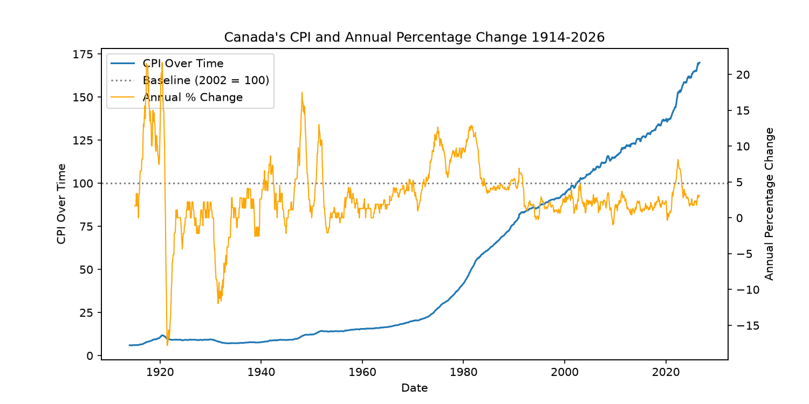

# FINE3300-2026-A2
Rebekha Lee - FINE3300A F26 Assignment 2

## Introduction

The Consumer Price Index (CPI), published monthly by Statistics Canada, measures the average change in prices that Canadian consumers pay for a basket of goods and/or services over time. It is a key indicator of inflation. This project has been created in hopes of improving the Bank of Canada's (BoC) inflation calculator by accepting both month AND year, rather than just the year. The project has been created in the Python language using Pandas and the CPI data has been graphed using Matplotlib.

## Files

- `cpi_inflation.ipynb`: This notebook holds the entire project. It has the CPI graph, as well as the improved inflation calculator, along with the step-by-step thought process I had to create it. 
- `STATIC_INFLATIONCALC.csv`: This is the BoC's published monthly CPI data, ranging from 1914-2026. For more information, view https://www.bankofcanada.ca/rates/related/inflation-calculator/
- `cpi_graph.png`: This is the CPI graph exported as a .png file.
- `README.md`: You are here! Feel free to use this notebook as a directory.

## How to run the project

1. To use, please ensure you have installed Python, Pandas, Matplotlib, and Jupyter or VS Code. 
2. To access the files, download or clone this repository and open with VS Code. 
3. Open the notebook and use the Run All function. User will be prompted with questions to answer to use the inflation calculator.
4. The calculator will ask for the price of the good/service and the two dates the user would like to compare. Please ensure you use the correct YYYY-MM format.
5. Upon invalid entries, the user will face an error message such as "Price must be a positive number," or "Please enter the YYYY-MM format."

## CPI graph



In the CPI graph, the blue line represents the CPI trend over the years, the orange line represents the annual percentage change, and the dotted grey line is the 2002 base line of CPI 100. 

Overall, the CPI went up from 6.0 to 170.0 with the price of goods/services being about 28.33x higher. Something that cost $1 in January of 1914 now costs $28.33 as of September 2026. Some key noticeable timelines include the following:
- Around 1920s: the orange line, which again represents the annual percetnage change, spiked very high and then dropped to zero largely due to the end of World War I (WWI). During and after WWI, there was a lot of demand which made goods pretty scarce. This caused inflation to peak at about 21.6%. Then when wartime prices collapsed, prices fell about 17.8% in a year due to deflation. 
- Early 1930s: due to the Great Depression, demand and employment collapsed, and prices fell for several years in a row (1931–1933), by up to about −12% a year. You can see the blue line dip slightly in those years.
- Late 1940s: after World War II, wartime price controls ended and consumer demand pushed inflation to about 17.5% in early 1948. There was another spike around 1951 due to the Korean War.
- 1970s - early 1980s: the “Great Inflation” where oil price shocks drove inflation above 10% for much of 1974–1982, peaked near 12.9% in 1981. Very high interest rates in the early 1980s eventually brought it down. This is also where the blue line is steepest.
- 1991 onward: the Bank of Canada adopted inflation targeting in 1991 and aimed for about 2%. Thus, we can see that the orange line is much calmer after that. From 1992-2019, inflation averaged about 1.8%, and the CPI also rose at a steadier slope. Since then, there are some exceptions we can note such as the spike to about 6.9% in January 1991 being partly due to the new GST and the dip below zero in 2009 (about −0.9%) coming from the global financial crisis and falling oil prices. 
- 2021-2022: this is where post COVID-19 inflation took effect. Supply chain problems, an energy price spike (made worse by the war in Ukraine) and strong demand pushed inflation to 8.1% in June 2022, which was reportedly the highest in about 40 years. It has since come back down to about 3%, but prices haven't fallen back along with it. The CPI went from about 138 to 170 since early 2021, which is about 23% higher.
The CPI crosses the dotted 2002 base line of 100 CPI in 2002, because 2002 is the base year, where the CPI is set to 100 by definition.

## Sample calculator output

Below is a sample run comparing $100 CAD in September of 1990 and September of 2026:

``` 
A basket of goods and services that cost $100.00 CAD in September 1990 would cost $215.74 CAD in September 2026.
Percent change: 115.74%
Number of years: 36.00
Average annual rate of inflation: 2.16%
CPI of the first period: 78.8
CPI of the second period: 170.0
```